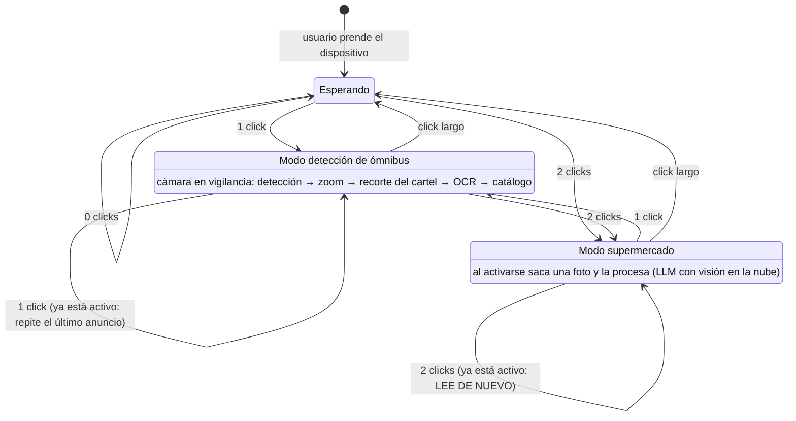
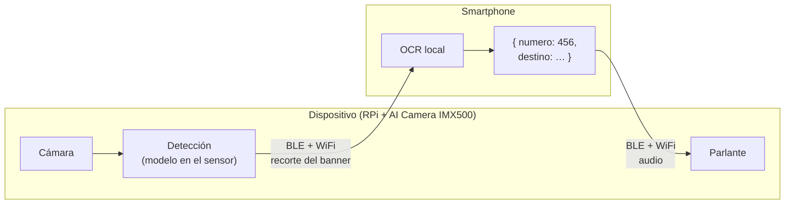
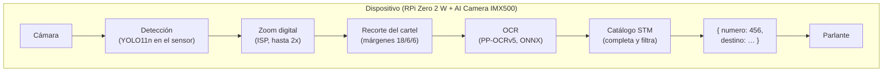
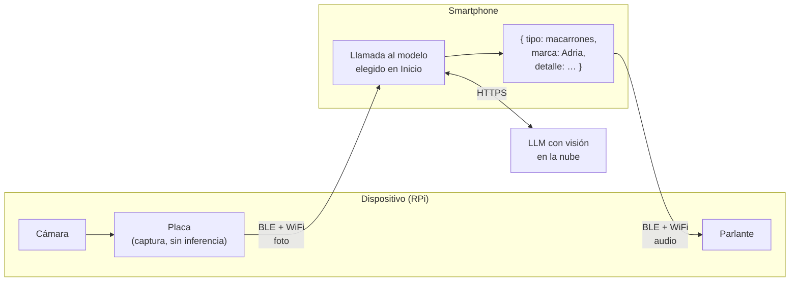

# Arquitectura

Arquitectura del sistema, diagramas de componentes y de flujo de datos, y los registros de decisión
(ADRs).

- **Vista general**: app ↔ dispositivo, con el procesamiento repartido según el caso de uso.
- **Integración app ↔ dispositivo**: [ADR 0003](adr/0003-enlace-placa-telefono.md). BLE (GATT)
  siempre vivo como plano de control (es lo único que despierta a la app con el teléfono en el
  bolsillo); la foto del modo supermercado viaja por el AP WiFi de la placa. El audio sale por donde
  elige el usuario: el teléfono o el dispositivo. En la placa es hoy una salida PWM provisional
  (`audremap`), con un transductor de conducción ósea previsto en la carcasa; no se usa A2DP, que
  compartiría la antena con BLE y WiFi.
- **Flujo de reconocimiento**: por caso de uso desde el [ADR 0006](adr/0006-pipelines-por-caso-de-uso.md).
  Ómnibus = detección en el dispositivo (**dentro del sensor IMX500**, sin TPU aparte) → zoom digital
  sobre el cartel → recorte con márgenes → OCR en la Pi → catálogo de líneas → anuncio; corre en la
  placa desde el 2026-09-15. Supermercado = LLM con visión en la nube, elegido por el usuario →
  anuncio (decidido el 2026-08-30; el respaldo local sigue abierto). Los tres flujos, dibujados, en
  [Flujos por caso de uso](#flujos-por-caso-de-uso).
- **ADRs**: ver [`adr/`](adr/README.md) para el índice completo (0001 offline-first, 0002 Supabase,
  0003 enlace placa ↔ teléfono, 0004 runtime on-device, 0006 pipelines por caso de uso, 0007
  botones físicos y modos, 0008 proxy de claves, 0009 idioma del código, 0010 tema oscuro único,
  0011 errores sólo en la telemetría). Por escribir: la plataforma (RPi Zero 2 W + AI Camera IMX500),
  React Native (Expo) y el 0005 (design system y accesibilidad).

## Modos de operación (diagrama canónico)

Decidido en [ADR 0007](adr/0007-botones-fisicos-modos-de-operacion.md): el reconocimiento
funciona por **modos explícitos** activados con el botón físico del dispositivo, nunca con audio no
solicitado. Cada modo mapea a un pipeline del
[ADR 0006](adr/0006-pipelines-por-caso-de-uso.md). Este diagrama es la fuente canónica; los ADRs
y la skill lo referencian sin duplicarlo.

En reposo el dispositivo está **conectado y esperando**: ni captura ni anuncia. Cada transición de
modo se anuncia por audio, porque el usuario no tiene otro indicador de estado.

**Un gesto nombra un modo, no un paso** (actualización del 2026-09-09, ver ADR 0007): 1 click es
siempre ómnibus y 2 clicks siempre supermercado, esté el dispositivo donde esté. Entrar a un modo
desactiva el anterior. Hasta esa fecha los clicks sólo valían desde *esperando* y cambiar de modo
exigía un click largo en el medio; probado en la mano, se sentía como que el botón estaba roto.

**Dos clicks piden una lectura, siempre** (actualización de 2026-10, ver ADR 0007). Estando ya en
supermercado, el doble click no cambia de modo y aun así saca una foto nueva: frente a la góndola el
usuario repite el gesto para leer el producto siguiente. Hasta esa fecha la captura se disparaba con
la *transición* de modo, así que el segundo doble click no hacía nada y el botón se sentía muerto (la
misma queja que la actualización anterior arregló un nivel más arriba).

**Un click en ómnibus repite el último anuncio** (desde el 2026-09-16, #88; `core.py`). Ómnibus ya
está vigilando solo, así que repetir el gesto no pide una lectura nueva: devuelve lo último que se
dijo, para quien no llegó a escucharlo.

Los dos modos se comportan distinto por naturaleza, y eso es deliberado: **ómnibus es continuo**
(la cámara queda vigilando y anuncia cada ómnibus que aparece, una sola vez por ómnibus) mientras que
**supermercado es puntual**: activarlo saca una foto y la procesa, porque el usuario está parado
frente a la góndola apuntando a un producto.

## Flujos por caso de uso

Transcripción de [`documents/logicas-casos-de-uso.pdf`](../../documents/logicas-casos-de-uso.pdf),
el diagrama dibujado a mano en el que se acordaron los tres flujos. Están acá en mermaid y no como
imagen porque así se versionan como texto, se leen en un diff y GitHub los renderiza; el PDF queda
como registro de la fuente.

El diagrama original suponía que el **audio siempre sale por el parlante del dispositivo**, porque
el usuario tiene las manos libres y no mira el teléfono. Desde el 2026-09-14 (#83, #89 y #90) el
usuario elige la salida, teléfono o dispositivo, y la elección vale para todos los sonidos; el
teléfono queda siempre como respaldo. Lo que cambia entre casos es **dónde corre cada modelo** y,
por lo tanto, qué viaja por el enlace.

### Caso ómnibus A: modelo parcial en la Raspi (descartado)

El dispositivo detecta el ómnibus y recorta el cartel, y por el enlace viaja el **recorte**, no el
frame entero. El OCR corre en el teléfono. Se descartó el 2026-09-04 a favor del caso B; queda como
registro de la alternativa evaluada. (Cuando se dibujó, la detección iba en un Coral TPU; desde el
2026-09-07 corre dentro del sensor IMX500.)

### Caso ómnibus B: modelo completo en la Raspi (el vigente)

Todo en el dispositivo: no hay enlace en el camino de reconocimiento, y el teléfono sólo recibe el
texto para anunciarlo si el usuario eligió esa salida. Es el caso que mejor cumple el ADR 0001.

El detector del IMX500 ve siempre el campo completo; el zoom (`ScalerCrop` del ISP, hasta 2x, ADR
0006 actualización 2026-10-19) sólo agranda el cuadro del que sale el recorte. El recorte suma
márgenes alrededor del box (18 % a la izquierda, 6 % a la derecha y 6 % arriba y abajo) para no cortar
el primer dígito del número de línea. El catálogo del STM completa la mitad del cartel que el OCR no
leyó y descarta lo que no conoce: sólo se dice una línea o un destino que existen.

### Caso supermercado: modelo en la nube

El dispositivo sólo captura y transmite; el reconocimiento lo hace un **LLM con visión** al que
llama la app a través del proxy propio (ADR 0008). Es el único camino que sale a internet (ADR 0001
enmendado + ADR 0006): el usuario está quieto frente a la góndola y tolera latencia a cambio de
precisión.

**La foto la saca la placa** y baja al teléfono por WiFi (ADR 0003). Hasta el 2026-09-08 la cámara
del teléfono ocupaba ese lugar mientras no había hardware; con la placa andando se retiró, y sin
dispositivo conectado la app no lee: el botón queda deshabilitado y la pantalla dice por qué.

> **Estado (2026-09-01).** El caso supermercado era el que estaba en desarrollo; los dos casos de
> ómnibus quedaron en espera hasta tener el hardware para medirlos.
>
> **Actualización (2026-09-04).** El equipo eligió el **caso B** para ómnibus (todo en la placa) y
> confirmó el flujo de supermercado tal como está dibujado. El "BLE + WiFi" de las flechas se
> resuelve en el [ADR 0003](adr/0003-enlace-placa-telefono.md): BLE siempre, WiFi para la foto.
>
> **Actualización (2026-10-22).** Los dos modos corren en el dispositivo real. Ómnibus funciona en la
> placa desde el 2026-09-15 y suma el catálogo (2026-10-06/07), la evidencia de cada lectura
> (2026-10-12), el zoom digital (2026-10-19) y los márgenes del cartel (vigentes otra vez desde el
> 2026-10-22, tras una prueba sin márgenes). Pendiente: la prueba en la calle con y sin zoom.
