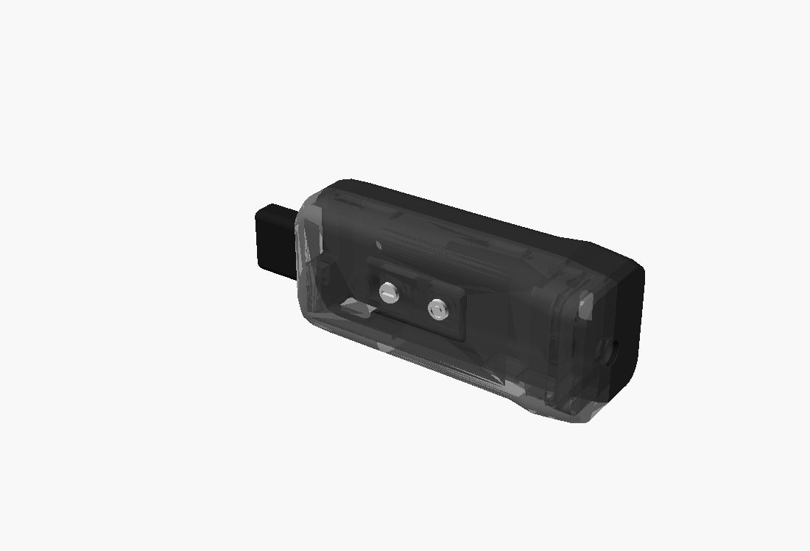

# Carcasa VIA Clara v0.9 — dos mitades con cierre a presión

Modelo paramétrico en **OpenSCAD** (`via_clara_v0_9.scad`) para la Raspberry Pi Zero 2 W + Waveshare
UPS HAT (C) + Raspberry Pi AI Camera + auricular de conducción ósea, montado sobre la patilla de los
lentes. Parte de la v0.8 (`via_clara_v0_8.scad`, que se conserva como referencia) y aplica la
especificación final del 2026-10-14. Regenerar todo: `./export.sh` (STL, imágenes y verificación de
interferencias; sale con error si alguna pieza choca).




## Qué cambió respecto de la v0.8, punto por punto de la especificación

| Especificación | v0.8 | v0.9 |
|---|---|---|
| 2. Sin tornillos exteriores, cierre por click | 2 tornillos pasantes con tuerca y orejas que sobresalían | **6 pestañas a presión** (3 arriba, 3 abajo) en la mitad derecha, con rampa de entrada de ~19° y cara de retención a 45° para que se pueda abrir sin romperlas; **labio de alineación** continuo en el resto de la junta; **2 pernos** de alineación en la pared trasera; ranura para abrir con la uña o una moneda atrás |
| 3. Sin tapa frontal de cámara | tapa separada con 4 clavijas | la **cámara queda dentro de las dos mitades**: el PCB lo atrapan **nervios en sus cuatro bordes** (adelante y atrás del PCB), sin clavijas en sus agujeros, sin tocar el bloque óptico ni los agujeros de montaje; **una sola abertura frontal** Ø 6,4 con chaflán, centrada en el lente |
| 4. Sin pines a través de la Raspberry | ya no tenía pines, pero las almohadillas eran macizas | **almohadillas con alojamiento hexagonal** para los separadores metálicos existentes y un **collar de plástico** alrededor para refundir con el soldador sobre el separador. Los separadores se fijan **antes** de que entren las placas: el calor nunca llega a una placa |
| 4. Interruptor de la UPS HAT accesible | quedaba tapado por la tapa de la cámara | **ventana en la cara interna** (lado cabeza), frente a la llave |
| 5. Auricular óseo, 14 mm | alojamiento agrandado a 16,8 | **14 mm nominales + 0,2 de holgura por lado** (14,4). El brazo sigue siendo **pieza aparte** (va enchufado a su zócalo y no se puede imprimir junto con la mitad), con el mismo canal hueco para el cable. Se corrigió un choque de 0,6 mm entre el brazo y su zócalo que venía de la v0.8 |
| 6. Dos botones alineados con sus interruptores | dos agujeros sin lugar para los interruptores (no entraban) | **botón de comando y de volumen**, cada uno con su **cajón** para un pulsador SMD 6 × 6 × 2,5 que entra deslizando desde abajo y queda trabado. Una isla en relieve los hace fáciles de encontrar al tacto; el de comando lleva un **anillo**, el de volumen una **raya** |
| 1. Canal para el elástico | dos anclajes chicos | **dos puentes** en la cara interna para un elástico plano de 6 mm, alejados del zócalo del brazo |
| 8. Sin espacios desperdiciados | ventana de 29 × 23 en la cara externa ("acceso USB/HDMI") que no daba acceso a nada | eliminada (los conectores de la Pi miran hacia arriba y abajo, no hacia el costado) |
| — | en la v0.8 la cavidad perforaba la piel arriba y abajo en el extremo trasero | perfil trasero corregido |

También se agregó una **ventana de carga** abajo para el micro USB de la UPS HAT. La especificación no
la pedía, pero en la v0.8 sólo se podía cargar sacando la tapa de la cámara, y esa tapa ya no existe.
Se apaga con `CHARGE_PORT = false`.

## Antes de imprimir: medir con calibre

Todo lo que el modelo no pudo verificar está marcado `MEASURE` en el `.scad`. Es la lección de la v1:
la impresión falló por medidas sacadas de fotos.

| Parámetro | Qué medir | Valor actual | Si está mal |
|---|---|---|---|
| `AI_CAM_LENS_FROM_TOP` | centro del lente al borde superior del PCB de la cámara (el borde opuesto al conector) | **14,4** (product brief oficial RP-008147). La v0.8 usaba 12,5: son **2 mm de diferencia** | la abertura frontal no queda centrada |
| `STACK_T`, `STANDOFF_BELOW`, `STANDOFF_AF` | alto total del conjunto Pi + HAT desde la punta de los separadores; largo de separador bajo la placa; entre caras del hexágono | 16,5 / 4,0 / 5,0 | si el conjunto es más alto que 16,5, choca con los cajones de los botones (hoy hay 0,4 mm de luz) |
| `UPS_SWITCH` | posición de la llave de la HAT | borde corto delantero, centrada | la ventana no queda frente a la llave |
| `CHARGE_X`, `CHARGE_Y` | micro USB de carga de la HAT | borde largo inferior, a ~61 del extremo de la llave (foto de Waveshare) | ventana corrida |
| `SWITCH_T` | alto total del pulsador con el actuador | 2,5 | botón flojo o siempre apretado |
| `TRANSDUCER_SIZE` | el transductor óseo | 14,0 | — |

Lo más barato para validar antes de imprimir las mitades enteras: imprimir sólo la nariz (cortar el STL
en x < −28 en el laminador) y probar la cámara, la abertura y el cierre de las dos pestañas delanteras.

## Armado (el orden de la especificación)

1. **Separadores a las almohadillas.** Desatornillar los separadores metálicos de las placas. Calentar
   cada uno con la punta del soldador (~200 °C para PLA) y presionarlo dentro de su alojamiento
   hexagonal de la mitad izquierda hasta que asiente.
2. **Fijarlos.** Refundir el collar de plástico sobre el hexágono con la punta del soldador. Dejar enfriar.
3. **Electrónica.** Atornillar el conjunto Pi + HAT a los separadores con sus tornillos originales.
   Conectar la batería, el flex de la cámara y los cables de los pulsadores.
4. **Cámara.** Enfocar antes de cerrar. Apoyar el PCB en los nervios de la mitad izquierda, con el
   conector hacia abajo, y hacer el rulo del flex por el hueco de abajo hacia el conector CSI.
5. **Auricular.** Pasar el cable por el puerto de la mitad izquierda y el canal del brazo, y enchufar
   el brazo en su zócalo.
6. **Pulsadores y botones.** Meter cada botón desde adentro por su agujero de la mitad derecha y
   deslizar el pulsador en su cajón desde abajo hasta que pase el escalón.
7. **Cerrar.** Presentar la mitad derecha sobre la izquierda (los pernos traseros guían) y apretar
   hasta escuchar las seis pestañas. Para abrir: uña o moneda en la ranura trasera.

## Impresión

PETG si es posible: las pestañas trabajan a ~1,2 % de deformación y el PETG la aguanta mejor que el
PLA en aperturas repetidas. Boquilla 0,4, capa 0,16, 3 perímetros, relleno 25 %.

| STL | Orientación | Soportes |
|---|---|---|
| `01_left_half_v0_9.stl` | sobre la cara externa | **de árbol**, sólo afuera: la cara externa es curva, y el zócalo del brazo y los puentes del elástico sobresalen. Bloquearlos dentro de la cavidad |
| `02_right_half_v0_9.stl` | sobre la cara externa; las pestañas crecen hacia arriba | de árbol bajo la isla de botones y la nariz |
| `03_bone_arm_v0_9.stl` | acostado | de árbol |
| `04_buttons_command_volume_v0_9.stl` | los dos botones, parados sobre la brida | no |
| `00_assembly_check_v0_9.stl` | — | **no se imprime**: es el conjunto cerrado, para revisar interferencias en el laminador |

Peso de plástico macizo de todas las piezas: ≈ 35 g en PLA. Con 25 % de relleno queda bastante menos.

## Archivos

```
via_clara_v0_9.scad   el modelo. PART = assembly | left | right | bone | button_command | button_volume
                      | print_* | hardware | check_*;  SHOW_HW y EXPLODE para la vista armada
via_clara_v0_8.scad   la versión anterior, sin tocar, como referencia
export.sh             regenera stl/ e img/ y corre las 6 verificaciones de interferencia
stl/  img/
```

Las verificaciones (`check_*`) intersecan cada pieza con las maquetas del hardware y con las demás
piezas: mitades entre sí, mitades contra placas/cámara/llave/pulsadores, botones, brazo contra
mitad y transductor, y cajones contra el conjunto de placas. Todas dan vacío (las mitades y los
botones sólo se tocan en sus caras de contacto). Están verificadas **contra las maquetas**, no contra
las placas reales: valen tanto como las medidas de la tabla de arriba.
