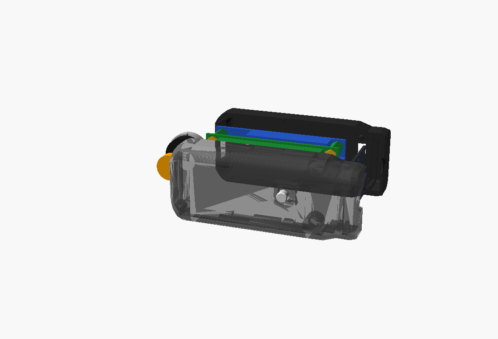
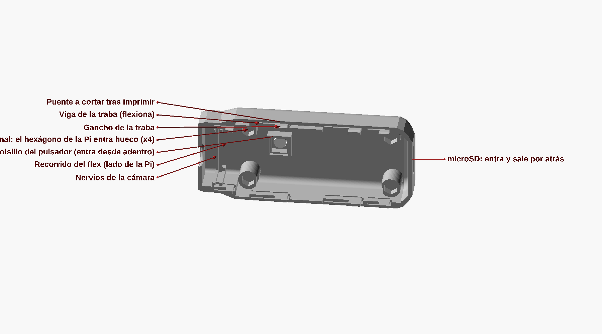
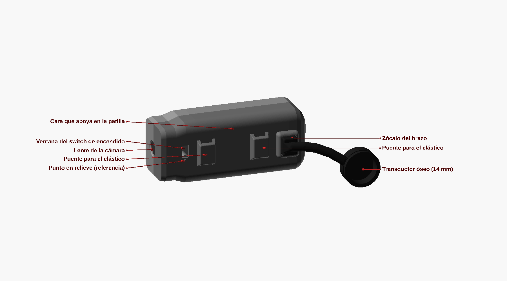

# Carcasa VIA Clara v0.20: dos mitades con cierre a presión

Modelo paramétrico en **OpenSCAD** (`via_clara_v0_20.scad`) para la Raspberry Pi Zero 2 W con el header
soldado, la Waveshare UPS HAT (C) unida a su batería 803040, la Raspberry Pi AI Camera y el auricular
de conducción ósea, montado sobre la patilla de los lentes. **La v0.20 se imprimió y se armó completa el
2026-10-30, y quedó perfecta.** La v0.8 (`via_clara_v0_8.scad`) se conserva como referencia.
Para regenerar todo, correr `./export.sh`: arma los STL, las imágenes y las verificaciones, y sale con
error si algo falla.



Las mitades miden **87,2 mm de largo y 37,2 de alto**, sin contar el brazo del auricular.

## Piezas

| STL | Qué es | Orientación | Soportes |
|---|---|---|---|
| `01_left_half` | mitad del lado de la cabeza, con el switch de encendido | cara cabeza abajo | bajo la cara cabeza; bloquearlos dentro de la cavidad |
| `02_right_half` | mitad externa: zócalos, botón, trabas | cara externa abajo | sólo bajo el ahusado trasero y la nariz; **ninguno dentro de los zócalos hexagonales**. Después de imprimir, cortar los puentes de las vigas de las trabas |
| `03_bone_arm` | brazo del auricular, con la copa | acostado | de árbol |
| `04_mode_button` | botón: un cilindro que se pega al pulsador | parado | no |
| `07_transducer_cover` | tapa a click del auricular, con una ranura hacia el oído | disco abajo | no |
| `00_assembly_check` | todo armado | — | **no se imprime**: para mirar en el laminador |

Ya no existen la corredera (05), que reemplaza el switch de panel, ni la tapita del botón (06): el
pulsador queda firme en su bolsillo. PETG si es posible, o PLA; boquilla 0,4, capa de 0,12 a 0,16,
3 perímetros. Las curvas salen con 128 segmentos.

## Lo que fijaron las impresiones (v0.12 a v0.20)

| Parte | Cómo quedó | De dónde salió |
|---|---|---|
| Cámara | ranura del PCB de 1,62 (nervios de 1,2 a 0,25 de luz), 5 mm del centro del nervio delantero a la cara, 4,2 mm de lugar para el flex, y la esquina del nervio delantero abierta, porque ahí la cámara tiene un componente | narices de prueba de la v0.12 y la v0.13 |
| Trabas delanteras | detrás de las guías de la cámara: encima de ellas costaban y se partieron | impresión de la v0.11 |
| Separadores sobre la Pi | **zócalos hexagonales huecos de 5,0 entre caras, 3,5 de profundidad**, en postes de Ø 8,2 recortados donde tocarían el header y los puertos | `test_hex_sizes` (v0.13; el 5.º tamaño) y la v0.15, que con 1,5 no cerraba |
| Auricular | redondo, Ø 14 × 5: copa de **Ø 17 × 6** (la de Ø 15 no entró) y tapa sólida a click con una ranura hacia el oído | v0.15 a v0.17 |
| Botón | un cilindro de Ø 5, pegado al pulsador SMD de 4 × 4 × 1 | v0.15 |
| Encendido | **switch deslizante de panel**, cableado al HAT, en lugar de la llave del HAT y la corredera impresa. Ventana de **4,2 × 7,4** en la cara cabeza y dos pernos de **Ø 2,3 a 14,8** entre centros y 2 de alto, para los agujeros de la pestaña; se fija con gotita. La ventana va 2 mm más abajo que la de la corredera, para que la pestaña no toque la esquina redondeada de arriba | `test_panel_switch` (v0.18 y v0.19) |

## Todas las versiones

`versions/` guarda los STL de cada versión tal como se mandaron a imprimir, con su `LEEME`: de la v0.9 a
la v0.20, incluidas las piezas de prueba (narices, tamaños de hexágono, separaciones del switch). Es el
registro del proceso: no se borra ni se pisa una versión anterior. `./export.sh` vuelve a crear los STL
de la versión vigente en `stl/`, que git ignora.

## Armado

1. **Botón.** Soldar los cables al pulsador de 4 × 4 y pegarle el cilindro (pieza 04). Meterlo desde
   adentro de la mitad derecha, con el cilindro por el agujero.
2. **Cámara y flex.** Conectar el flex a la cámara y al CSI de la Pi **antes** de poner el conjunto.
3. **Electrónica.** Bajar el conjunto HAT + batería + Pi, **con la Pi hacia abajo**, en la mitad derecha:
   los hexágonos de la Pi entran en los zócalos. La cámara entra en su ranura con el conector hacia la Pi.
4. **Switch.** En la mitad izquierda, desde adentro, pasar la perilla del switch por su ventana y
   calzar la pestaña en los dos pernos; una gota de gotita.
5. **Auricular.** Pasar el cable por el puerto de la mitad izquierda y el canal del brazo, enchufar el
   brazo en su zócalo, poner el transductor en la copa y cerrar con la tapa (pieza 07).
6. **Cerrar.** Bajar la mitad izquierda sobre la derecha hasta escuchar las ocho trabas. Para abrir:
   uña o moneda en la ranura trasera.

## Guía con flechas

`img/guide/` tiene cinco vistas con flechas que dicen para qué es cada ranura, agujero y pieza
(`outer`, `head`, `left_inside`, `right_inside`, `exploded`). Las genera `export.sh` a partir de
`via_clara_v0_20_guide.scad`.




## Archivos y verificaciones

```
via_clara_v0_20.scad         el modelo. PART = assembly | left | right | bone | button | grille |
                             print_* | hardware | check_*;  SHOW_HW y EXPLODE para la vista armada
via_clara_v0_20_guide.scad   la guía con flechas (img/guide/); no se imprime
via_clara_v0_8.scad          la versión de partida, sin tocar, como referencia
export.sh                    regenera stl/ e img/ y corre las verificaciones
versions/                    los STL de cada versión impresa, v0.9 a v0.20
```

`export.sh` comprueba que cada pieza imprimible sea **un solo sólido** que apoya en la cama, y corre
**16 verificaciones** de interferencia que tienen que dar vacío o un contacto de volumen cero: las
mitades entre sí y contra las maquetas del hardware, los zócalos contra los hexágonos, el botón, los
pernos del switch, el recorrido del flex, el brazo y su tapa, y los caminos de armado (botón, conjunto,
cámara). Valen **contra las maquetas**, y las maquetas valen tanto como las medidas: lo que no tienen
(el cuerpo del switch de panel, por ejemplo) no lo ven.

## De dónde salen las medidas

| Componente | Fuente |
|---|---|
| Raspberry Pi Zero 2 W | plano mecánico oficial: 65 × 30, agujeros 58 × 23 |
| AI Camera | product brief (sept. 2024), pág. 4, corregido con las impresiones |
| UPS HAT (C) | wiki de Waveshare (fotos escaladas) y la impresión de la v0.9 |
| Hexágonos, disipador, pulsador, auricular, switch | medidos con calibre y con piezas de prueba |

El conjunto, de la cara cabeza a la externa: cabezas de los tornillos Phillips, UPS HAT, batería
(del lado de los pogo pins), Pi, y encima de la Pi el header y los hexágonos. Adelante quedan el CSI
y la cámara; atrás, la microSD (sale por una ranura del extremo trasero) y el micro USB de carga.
